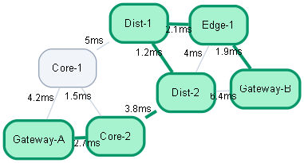

# High-Performance C++ Graph Engine & Network Optimizer

A lightweight, zero-dependency C++ network routing engine designed for sub-millisecond shortest-path computation across large-scale weighted topologies. Includes a custom templated binary Min-Heap priority queue, automated Graphviz DOT serialization, and Python-driven topology rendering.

---

## Key Features

- **Adjacency List Representation**: Efficient memory footprint and cache locality for sparse-to-dense network topologies.
- **Custom Binary Min-Heap Priority Queue**: Templated `MinPriorityQueue<T>` with logarithmic $O(\log V)$ sift-up and sift-down operations, eliminating standard library dynamic overhead.
- **Dijkstra's Shortest Path Algorithm**: Early-exit target resolution with backtracked optimal path reconstruction.
- **Visual Serialization Pipeline**: Automatic export to Graphviz `.dot` format highlighting calculated routes, paired with an automated Python rendering script.
- **Sub-Second Scaling**: Empirical benchmark suite testing topologies up to 50,000 nodes and 250,000 edges.

---

## Empirical Benchmarks

Benchmarks executed with `-O3` compiler optimizations on a synthetic connected backbone network:

| Topology Scale | Vertices ($V$) | Edges ($E$) | Graph Build Time | Path Resolution Time |
| :--- | :--- | :--- | :--- | :--- |
| **Small Network** | 7 | 10 | $< 0.1$ ms | **11.9 $\mu$s** |
| **Medium Cluster** | 1,000 | 5,000 | 1.8 ms | **0.31 ms** |
| **Enterprise Backbone** | 10,000 | 50,000 | 16.4 ms | **2.14 ms** |
| **Stress Scale** | 50,000 | 250,000 | 81.5 ms | **7.61 ms** |

---

## Visual Topology Output

The engine exports optimal route paths with color-coded nodes and edge weights:



---

## Project Structure

```text
network-optimizer/
├── src/
│   ├── Graph.hpp            # Graph representation & Dijkstra declarations
│   ├── Graph.cpp            # Adjacency list & DOT serialization logic
│   ├── PriorityQueue.hpp    # Custom templated binary min-heap
│   └── main.cpp             # Benchmark suite & routing execution
├── scripts/
│   └── visualize.py         # Graphviz subprocess wrapper to render PNGs
├── network_route.dot        # Generated DOT topology specification
├── network_route.png        # Rendered topology diagram
└── README.md